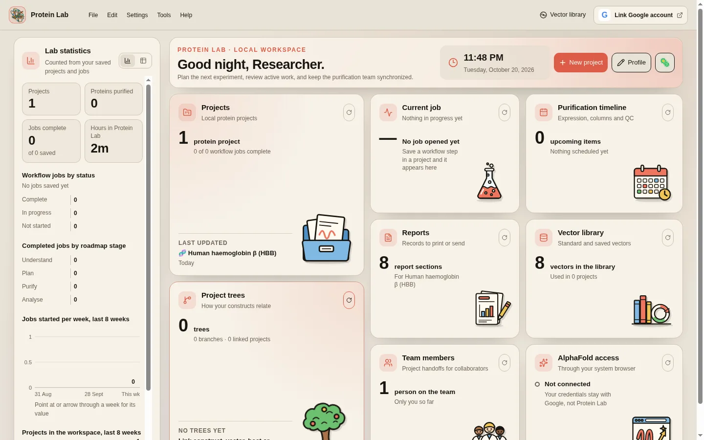

# Protein Lab

Warning, project is in beta testing. There may be incorrect information or features that are not accessible. Disclaimer: Claude and Codex AI wrote most of the code.

Protein Lab is a desktop workspace for protein expression and
purification. Use it to plan a protein construct to purify, design an expression vector, plan a
purification, and analyse chromatograms and gels. The app runs a local Python
engine. Your projects stay on your computer.



## Contents

- [Download and install](#download-and-install)
  - [macOS](#macos)
  - [Windows](#windows)
  - [Ubuntu (Linux)](#ubuntu-linux)
  - [Arch Linux](#arch-linux)
- [First steps](#first-steps)
- [Build from source](#build-from-source)
- [Project layout](#project-layout)
- [Contributing, security and license](#contributing-security-and-license)

## Download and install

Get the files from the
[current beta release](https://github.com/hammonsnick1/protein-lab/releases/tag/v0.3.0-beta.1).
Use the file for your system:

| System | File |
| --- | --- |
| macOS, Apple silicon (M1 and later) | `Protein-Labs-0.3.0-beta.1-arm64.dmg` |
| macOS, Intel | `Protein-Labs-0.3.0-beta.1-x64.dmg` |
| Windows 10 or 11 (64-bit) | `Protein-Labs-0.3.0-beta.1-x64.exe` |
| Ubuntu or Debian | `Protein-Labs-0.3.0-beta.1-amd64.deb` |
| Arch Linux | `protein-labs-0.3.0-beta.1-1-x86_64.pkg.tar.zst` |
| Other Linux | `Protein-Labs-0.3.0-beta.1-x86_64.AppImage` |

The installers are not signed with a paid developer certificate. Because of
this, macOS and Windows show a security warning the first time. The steps
below tell you what to do. Download the files only from this repository's
Releases page.

### macOS

1. Find your Mac type: open the Apple menu → **About This Mac**. "Apple M1",
   "M2" and later mean Apple silicon. "Intel" means Intel.
2. Download the `.dmg` file for your Mac type.
3. Double-click the `.dmg` file. A window opens.
4. Drag **Protein Lab** onto the **Applications** folder.
5. Eject the disk image: in Finder, click the eject button next to it.
6. Open **Applications** and double-click **Protein Lab**.

First launch (Gatekeeper):

1. macOS says it cannot verify the developer. Click **Done** (or **OK**).
2. Open **System Settings → Privacy & Security**.
3. Scroll down to **Security**. Find the message about Protein Lab and click
   **Open Anyway**.
4. Click **Open Anyway** again and enter your password.
5. Protein Lab starts. Later launches open normally.

If macOS says the app "is damaged and can't be opened", open **Terminal**,
run this command, then open the app again:

```sh
xattr -dr com.apple.quarantine "/Applications/Protein Lab.app"
```

To uninstall, quit Protein Lab and drag it from **Applications** to the Trash.

### Windows

1. Download `Protein-Labs-0.3.0-beta.1-x64.exe`.
2. Double-click the file.
3. Windows SmartScreen can show "Windows protected your PC". Click
   **More info**, then click **Run anyway**.
4. In the installer, click **Next**. You can keep the default folder. Click
   **Install**, then **Finish**. The app installs for your user only, so you do
   not need administrator rights.
5. Start **Protein Lab** from the Start menu or the desktop shortcut.

To uninstall, open **Settings → Apps → Installed apps**, find
**Protein Lab**, and click **Uninstall**.

### Ubuntu (Linux)

For Ubuntu 22.04 or later, 64-bit.

1. Download `Protein-Labs-0.3.0-beta.1-amd64.deb`.
2. Open a terminal.
3. Install the package. `apt` also installs the libraries that it needs:

   ```sh
   cd ~/Downloads
   sudo apt install ./Protein-Labs-0.3.0-beta.1-amd64.deb
   ```

4. Start **Protein Lab** from the app menu, or run `protein-labs` in a terminal.

To uninstall:

```sh
sudo apt remove protein-labs
```

### Arch Linux

1. Download `protein-labs-0.3.0-beta.1-1-x86_64.pkg.tar.zst`.
2. Open a terminal.
3. Install the package. `pacman` also installs the libraries that it needs:

   ```sh
   cd ~/Downloads
   sudo pacman -U protein-labs-0.3.0-beta.1-1-x86_64.pkg.tar.zst
   ```

4. Start **Protein Lab** from the app launcher, or run `protein-labs` in a terminal.

To uninstall:

```sh
sudo pacman -R protein-labs
```

### Other Linux (AppImage)

```sh
chmod +x Protein-Labs-0.3.0-beta.1-x86_64.AppImage
./Protein-Labs-0.3.0-beta.1-x86_64.AppImage
```

If your system has no FUSE 2, start it with
`APPIMAGE_EXTRACT_AND_RUN=1 ./Protein-Labs-0.3.0-beta.1-x86_64.AppImage`.

## First steps

1. Start Protein Lab. Wait until the start screen shows
   **Scientific engine ready**, then click **Start**.
2. On the dashboard, click **New project**. Type a name and paste an
   amino-acid sequence.
3. Follow the project workflow, from sequence research to the purification report.

The full user manual is in the app: **Help → User manual**. The same text is
in [protein-labs-web/docs/user-manual.md](protein-labs-web/docs/user-manual.md).

Projects are saved in your user profile. To save them in another folder, use
**File → Set project directory…**.

## Build from source

You need Node.js 22 or later and Python 3.11 or later.

Desktop app (lint, type check and tests):

```sh
git clone https://github.com/hammonsnick1/protein-lab.git
cd protein-lab/protein-labs-web
npm ci
npm run lint
npm run typecheck
npm test
```

Engine (tests):

```sh
cd protein-lab/protein-labs/backend
python3 -m venv .venv
.venv/bin/python -m pip install -r requirements-dev.txt
.venv/bin/python -m pytest
```

On Linux, `./build-and-install.sh` builds the engine and the AppImage and
installs them in this folder. Then `./protein-lab` starts the app and keeps
its data in `data/`. See [protein-labs-web/README.md](protein-labs-web/README.md)
for more build details.

The installers for all systems are built by
[.github/workflows/release.yml](.github/workflows/release.yml) when a `v*` tag
is pushed.

## Project layout

| Path | Contents |
| --- | --- |
| `protein-labs-web/` | Electron desktop shell, React interface, user manual |
| `protein-labs/backend/` | Local Python engine and its tests |
| `.github/workflows/` | CI checks, release build, install checks |
| `build-and-install.sh`, `protein-lab` | Local Linux build, install and launch |

## Contributing, security and license

Read [CONTRIBUTING.md](CONTRIBUTING.md), [SECURITY.md](SECURITY.md) and the
[Code of Conduct](CODE_OF_CONDUCT.md) before you open an issue or a pull request.

Protein Lab is released under the [MIT License](LICENSE). Third-party notices
are in [protein-labs/THIRD_PARTY_NOTICES.md](protein-labs/THIRD_PARTY_NOTICES.md).

Copyright © 2026 Nicholas Hammons.
